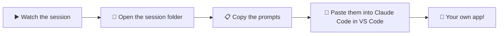

# Learn Claude: Build Real Apps Without Coding

**Free, session-by-session resources for the Elevexa AI YouTube series (in Hindi)**

*Claude Chat · Claude Cowork · Claude Code · VS Code*

---

## 👋 Welcome

This repo has everything from our live sessions: **the exact prompts I typed, the files Claude created, and the finished apps**.
You can open them, copy them and build them yourself.

> 🇮🇳 **Hinglish mein:** Har session ka folder kholiye, prompts copy kijiye, aur apne VS Code mein Claude Code ke saath wahi app khud banaiye. Coding aana zaroori nahi hai!

---

## 📚 Sessions

| # | Session | What you build | Resources | Video |
|:-:|---|---|---|:-:|
| 1 | **Claude Chat vs Cowork vs Code** + VS Code setup | Nothing yet. We learn the 3 "doors" and set up the kitchen 🍳 | [Notes](session-01-claude-chat-cowork-code/) | [▶️ Watch](https://www.youtube.com/watch?v=pVIQhLV3Msk) |
| 2 | **Build Your Own Presentation App** | A PowerPoint-style slide app, with a Batman game on the last slide 🦇 | [Prompts, code & live app](session-02-build-presentation-app/) | ▶️ Coming soon |
| 3 | **Adding AI Features to the App** | The same app, now writing slides on *any* topic by itself | Coming soon | Coming soon |

⭐ **Star this repo** to see each new session when it's added.

---

## 🧭 How to use this repo

1. **Watch** the session on YouTube.
2. **Open** that session's folder here. Each one has its own README.
3. **Copy the prompts** from `prompts.md`, one at a time, into Claude Code.
4. **Compare** your result with the finished app in the folder. Yours will look different, because Claude gets creative every time, and that's fine.

### Download the files
- **Easiest:** click the green **`<> Code`** button at the top of this page → **Download ZIP** → unzip it.
- **With Git:** `git clone https://github.com/varunbhtt21/elevexa-claude-series.git`

---

## 🛠️ What you need

| Tool | Cost | Link |
|---|---|---|
| **VS Code** (your "kitchen") | Free | [code.visualstudio.com](https://code.visualstudio.com) |
| **Claude Code** extension (your "chef") | Needs a paid Claude plan (Pro or higher) | [Claude Code docs](https://docs.claude.com/en/docs/claude-code/overview) |
| A web browser (Chrome, Edge, Safari) | Free | — |

Not set up yet? Session 1 shows the whole setup step by step.

---

## 🙋 Who is this for?

Marketers, operations teams, teachers, content creators, founders, and anyone curious about AI.
**No coding background needed.** If you can type a WhatsApp message, you can write a prompt.

---

**Made with ❤️ by [Elevexa AI](https://www.youtube.com/watch?v=pVIQhLV3Msk)**: simple, practical AI tutorials in Hindi.

If this helped you, ⭐ star the repo and 🔔 subscribe on YouTube!

