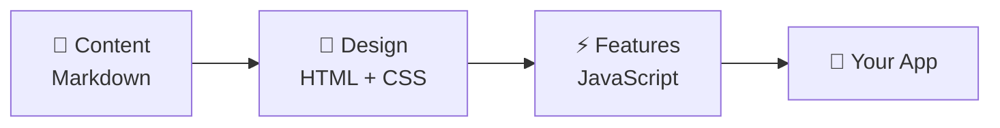

# Session 2: Build Your Own Presentation App 🦇

**From a blank folder to a working PowerPoint-style app, with a Batman game on the last slide. No coding, just prompts.**

[](https://varunbhtt21.github.io/elevexa-claude-series/session-02-build-presentation-app/my-presentation/)
[](prompts.md)


---

## 🏠 The big idea: every app has 3 layers

Think of building a **house**:

| Step | Layer | In a house | In our app | File |
|:-:|---|---|---|---|
| 1 | 📝 **Markdown** | Blueprint | The content: text, headings, points | [`batman.md`](my-presentation/batman.md) |
| 2 | 🧱 **HTML** | Walls & rooms | The structure: slides, titles, buttons | [`index.html`](my-presentation/index.html) |
|   | 🎨 **CSS** | Paint & decor | The style: colours, fonts, animations | [`styles.css`](my-presentation/styles.css) |
| 3 | ⚡ **JavaScript** | Electricity | The features: edit, themes, drag & drop, the game | [`script.js`](my-presentation/script.js) · [`game.js`](my-presentation/game.js) |



> **The recipe for any app:** Content → Design → Features. Claude Code writes all the code. You just describe what you want.

---

## 🚀 Try the finished app

**Online (nothing to install):** [**open the live app**](https://varunbhtt21.github.io/elevexa-claude-series/session-02-build-presentation-app/my-presentation/)

**On your computer:** download this repo → open the `my-presentation` folder → double-click **`index.html`**.

### ⌨️ Controls

| Key | What it does |
|---|---|
| `→` / `Space` | Next slide |
| `←` | Previous slide |
| `E` | ✏️ Edit the slide (click any text and type) |
| `Ctrl/Cmd + S` | 💾 Save your edits |
| `T` | 🎨 Change theme (5 themes) |
| `S` | 📑 Open the slide sidebar (drag cards to reorder, tick to skip) |
| `F` | ⛶ Fullscreen |

**🎨 Themes:** Classic Comic · Gotham Noir · Neon Arkham · Golden Age · Joker Chaos

**🎮 Bat-Dash game (last slide):** `Space` jump (tap again to double-jump, hold to glide) · `↓` dive · `X` throw a Batarang · `P` pause · `M` mute

---

## 🧑‍🍳 Build it yourself, step by step

1. Create an empty folder on your Desktop, e.g. `my-presentation`.
2. Open it in **VS Code** (File → Open Folder). If asked, click **Trust**.
3. Open **Claude Code** from the side panel.
4. 💡 Tip: set the mode (bottom right) to **Auto**, so Claude doesn't ask permission for every small change.
5. Send the prompts below **one at a time**. Wait for each one to finish before sending the next.

> 🔁 Swap **Batman** for your own topic: Salesforce, your product, a Diwali sale, a class lesson… anything!

### Step 1 · 📝 Content (Markdown)

```text
I want you to create 500 word markdown document on a topic : Batman
```
> Why "500 words"? Without a limit, Claude may write a very long document and take much longer.

```text
make it more formatted and structured
```
> 💡 Want to see it nicely or save it as a PDF? Paste the Markdown into [dillinger.io](https://dillinger.io) → **Export as → PDF**.

### Step 2 · 🎨 Design (HTML + CSS)

```text
I want a slide deck premium presentation app in html and css with amazing and beautiful theme. use award winning theme.
Make it more comical and fun with animations.
```
> When it's done, double-click `index.html` to open it in your browser. 🎉

### Step 3 · ⚡ Features (JavaScript)

```text
I want to add a javascript feature - I should be able to edit the content of the slide by selecting it, the experience should be smooth.
There should be an edit and save button.
```

```text
I want to add more js features :
1. I want more premium themes out of which I can select
2. There should be an autohide left side bar which contains slides as a card, I can select any card and drag it over to another card and it will get swapped. There should also be an skip slide checkbox, on tick the slide will get skipped
```

### 🎁 Bonus · A game inside your slides

```text
I want to add one slide at the end - There should be a batman game which I can play from my keyboard and it should be interactuve and fun.
```

All prompts, exactly as typed in the session → [`prompts.md`](prompts.md)

---

## 🧠 Prompt-writing tips from this session

- **Give a limit:** "500 words" keeps answers quick and focused.
- **Say the feeling you want:** words like *premium*, *award-winning*, *comical and fun*, *smooth* change the result a lot.
- **One feature at a time:** build in small steps, check it in the browser, then ask for the next one.
- **Number your requests:** "1. … 2. …" helps Claude not miss anything.
- **Refresh the browser** after every change to see what's new.

---

## 💪 Your homework

- [ ] Build the app on **your own topic**
- [ ] Add one feature of your own (ideas: a timer, speaker notes, dark/light switch, a quiz slide)
- [ ] Share a screenshot in the YouTube comments. I'd love to see it! 🙌

---

## 📂 What's in this folder

```
session-02-build-presentation-app/
├── README.md          ← you are here
├── prompts.md         ← every prompt used in the session
└── my-presentation/   ← the finished app
    ├── batman.md      ← 📝 content (Markdown)
    ├── index.html     ← 🧱 structure (HTML)
    ├── styles.css     ← 🎨 style (CSS)
    ├── script.js      ← ⚡ features (JavaScript)
    └── game.js        ← 🎮 Bat-Dash game
```

---

⬅️ [Session 1: Chat vs Cowork vs Code](../session-01-claude-chat-cowork-code/) · 🏠 [All sessions](../README.md) · ➡️ **Next: Session 3, Adding AI Features to the App** (coming soon)

<sub>Batman is a trademark of DC Comics. This is a fan-made learning example, used only to teach.</sub>
